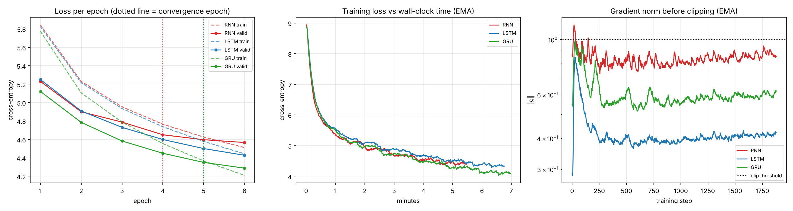
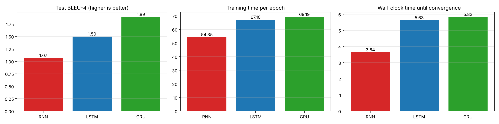
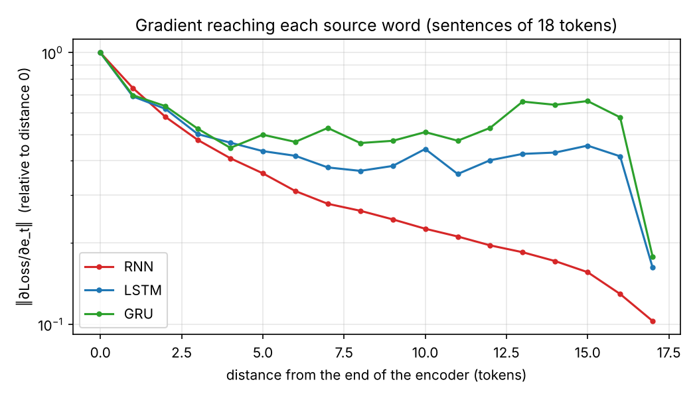

# Neural Machine Translation (DE → EN) with Seq2Seq: RNN vs LSTM vs GRU

Assignment for **Advanced Deep Learning: Recurrent Neural Network (RNN) & LSTM** (slide 59).

> **Assignment (Machine Translation)**
> * Use the DE-EN News Commentary parallel corpus from [WMT13](http://www.statmt.org/wmt13/translation-task.html#download)
> * Use an Encoder-Decoder (Seq2Seq) to build the MT system
> * Compare the results of three architectures (RNN, LSTM, GRU), when the model starts to converge (loss-function graphs), and computation time
> * Evaluation: BLEU score

## Repository contents

| Path | What it is |
|---|---|
| [`mt_seq2seq_assignment.ipynb`](mt_seq2seq_assignment.ipynb) | The full assignment: data pipeline, Seq2Seq model, training, BLEU evaluation, comparison plots, discussion |
| [`docs/lecture_analysis.md`](docs/lecture_analysis.md) | Slide-by-slide analysis of the lecture (RNN, BPTT, vanishing gradients, LSTM, GRU, Seq2Seq, BiLSTM) |
| [`results/cpu_reduced_run/`](results/cpu_reduced_run) | Executed notebook, plots and summary table from a reduced-size run on CPU |

## Method

* **Data:** WMT13 News Commentary v8 DE-EN (178,221 sentence pairs). The text is lower-cased and split into word and
  punctuation tokens. Duplicates are removed and pairs are kept if both sides have at most 30 tokens. A random
  train / valid / test split (2,000 sentences each for valid and test) is used, and the vocabulary is built from the
  training split only.
* **Model (slides 53 to 57):** an embedding plus a stacked recurrent **encoder** reads the reversed German sentence. Its
  final state (the **encoder vector**) initialises the **decoder**, which is also fed the encoder vector at every step
  (Cho et al., 2014). A linear layer and softmax produce the English vocabulary distribution.
  **Only the recurrent cell changes** between `nn.RNN` (tanh), `nn.LSTM` and `nn.GRU`. Everything else is identical:
  data, sizes, optimiser, seed and batch order.
* **Training:** teacher forcing, Adam, gradient-norm clipping (against exploding gradients), and early stopping on the
  validation loss. Epoch time is measured with CUDA synchronisation.
* **Evaluation:** greedy decoding and corpus BLEU-1…4 with NLTK (as in the tutorial linked on the slide), cross-checked
  with sacreBLEU.
* **Extra:** a direct measurement of the **vanishing gradient**, ‖∂Loss/∂embedding‖ for each source position.

## Results

### Reduced run (CPU): 20k training pairs, 1 layer × 256 units, 6 epochs

| | RNN | LSTM | GRU |
|---|---:|---:|---:|
| Recurrent parameters | 0.26 M | 1.05 M | 0.79 M |
| Best validation perplexity | 96.2 | 83.7 | **72.8** |
| Converged at epoch (within 2 % of best) | 4 | 5 | 5 |
| Time per epoch (CPU) | **54.3 s** | 67.1 s | 69.2 s |
| Test BLEU-1 | 25.6 | 25.5 | **27.7** |
| Test BLEU-4 | 1.07 | 1.50 | **1.89** |

**Observations**
* **Quality:** GRU > LSTM > RNN on validation perplexity and on every BLEU order. The gated cells are close to each
  other, as slide 52 says.
* **Convergence:** the RNN flattens out earliest (epoch 4) but at the highest loss. Its gradient norm stays closest to
  the clipping threshold.
* **Time:** cost per epoch follows the number of weight blocks, RNN (1) < GRU (3) ≈ LSTM (4). The embedding and the
  output softmax are the same for all three cells, which narrows the gap.
* **Vanishing gradient:** for the RNN, the gradient that reaches a source word decays steadily with its distance from
  the end of the encoder. For LSTM and GRU it stays roughly constant, which is the mechanism from slides 30 to 33 and
  48 to 49.
* Absolute BLEU is low because this run uses little data, a small model, word-level vocabularies, no attention and
  greedy decoding. The full configuration below is the one intended for the report.

### Full configuration (GPU)
*Pending:* about 112k training pairs, 2 layers × 512 units, 15 epochs. See *How to run*.

## How to run

1. Open `mt_seq2seq_assignment.ipynb` in Google Colab (*Runtime → Change runtime type → T4 GPU*) or locally with
   PyTorch.
2. The notebook downloads `training-parallel-nc-v8.tgz` from statmt.org. If that is blocked, put
   `news-commentary-v8.de-en.de` and `news-commentary-v8.de-en.en` in a `data/` folder next to the notebook.
3. Run all cells. Set `FAST = True` in the configuration cell for a quick CPU run.
   Results are written to `runs/` (`results.json`, `summary.csv`, plots) after each model, so an interrupted run
   resumes where it stopped.

Requirements: Python ≥ 3.9, `torch`, `numpy`, `pandas`, `matplotlib`, `nltk`, `sacrebleu`.
